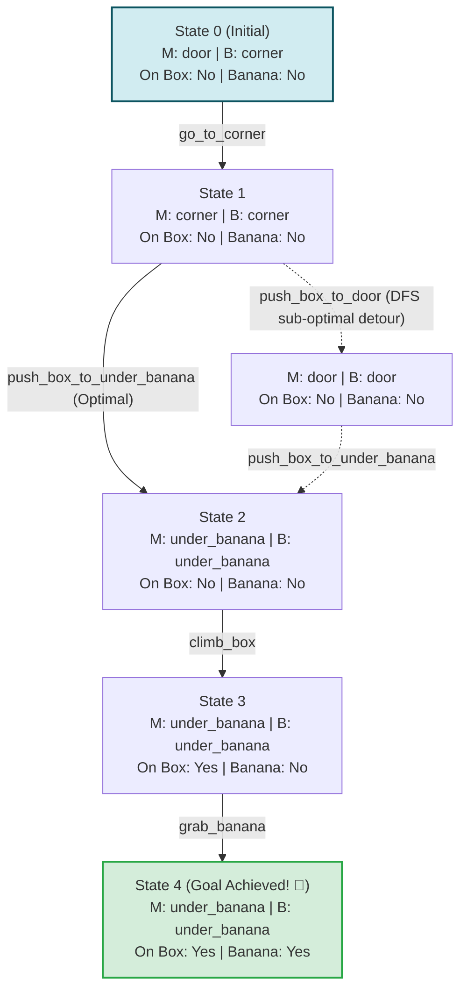

# 🐒 Monkey and Banana Problem in Artificial Intelligence

[](https://www.python.org/)
[]()
[]()
[](https://opensource.org/licenses/MIT)

A comprehensive, educational Python implementation of the classic **Monkey and Banana Problem** in Artificial Intelligence. This project models the problem using formal **State-Space Representation** and demonstrates how different search algorithms—**Depth-First Search (DFS)**, **Breadth-First Search (BFS)**, and **A\* Search**—tackle the problem with varying degrees of optimality.

---

## 📌 Table of Contents
- [📖 Problem Formulation](#-problem-formulation)
- [🧠 State-Space Formalization](#-state-space-formalization)
- [🔄 State Transition Diagram](#-state-transition-diagram)
- [⚡ Implemented Algorithms](#-implemented-algorithms)
  - [1. Depth-First Search (DFS)](#1-depth-first-search-dfs)
  - [2. Breadth-First Search (BFS)](#2-breadth-first-search-bfs)
  - [3. A* Search (Informed Heuristic)](#3-a-search-informed-heuristic)
  - [4. Simple Rule-Based Planner](#4-simple-rule-based-planner)
- [📊 Algorithm Comparison](#-algorithm-comparison)
- [📁 Project Structure](#-project-structure)
- [🚀 Quick Start & Execution](#-quick-start--execution)
- [🧪 Running Unit Tests](#-running-unit-tests)
- [💡 Key Theoretical Insights](#-key-theoretical-insights)

---

## 📖 Problem Formulation

The **Monkey and Banana Problem** is a famous benchmark problem in classical Artificial Intelligence, automated reasoning, and planning (popularized by John McCarthy and discussed extensively in Russell & Norvig's *Artificial Intelligence: A Modern Approach*).

### The Scenario:
* A monkey is in a room with a bunch of bananas suspended out of reach from the ceiling.
* In the room, there is a movable heavy wooden box.
* The room consists of three designated locations:
  1. `door` (Entrance)
  2. `corner` (Where the box starts)
  3. `under_banana` (Directly underneath the bananas)

### Physical Constraints:
1. **Reachability:** The monkey cannot reach the bananas directly from the floor.
2. **Elevation:** The monkey must climb onto the box to reach the bananas.
3. **Box Placement:** The box can only provide access to the bananas if it is located at `under_banana`.
4. **Push Mechanics:** The monkey can only push the box if the monkey and the box are at the same location, and the monkey is on the floor (not standing on top of the box).
5. **Climbing Mechanics:** The monkey can climb onto the box only when both are co-located at `under_banana`.

---

## 🧠 State-Space Formalization

### 1. State Representation
Each state is formalized as a 4-tuple:
$$\text{State} = (M, B, C, H)$$

Where:
* $M \in \{\text{'door'}, \text{'corner'}, \text{'under\_banana'}\}$: Current position of the monkey.
* $B \in \{\text{'door'}, \text{'corner'}, \text{'under\_banana'}\}$: Current position of the box.
* $C \in \{\text{True}, \text{False}\}$: Flag indicating whether the monkey is standing on the box (`True`) or on the floor (`False`).
* $H \in \{\text{True}, \text{False}\}$: Flag indicating whether the monkey has acquired the banana (`True`) or not (`False`).

### 2. Initial State & Goal Test
* **Initial State ($S_0$):** `('door', 'corner', False, False)`
  * Monkey is at the `door`
  * Box is in the `corner`
  * Monkey is on the floor (`False`)
  * Monkey does not have the banana (`False`)
* **Goal State ($G$):** Any state where $H = \text{True}$: `(*, *, *, True)`

### 3. Action Set & Preconditions

| Action | Preconditions | Effect (Next State) |
| :--- | :--- | :--- |
| `go_to_<loc>` | $M \neq \text{loc} \land C = \text{False}$ | $M' = \text{loc}$, $B' = B, C' = \text{False}, H' = H$ |
| `push_box_to_<loc>` | $M = B \land B \neq \text{loc} \land C = \text{False}$ | $M' = \text{loc}, B' = \text{loc}, C' = \text{False}, H' = H$ |
| `climb_box` | $M = B = \text{'under\_banana'} \land C = \text{False}$ | $C' = \text{True}$ |
| `grab_banana` | $C = \text{True} \land B = \text{'under\_banana'} \land H = \text{False}$ | $H' = \text{True}$ (Goal Reached) |

---

## 🔄 State Transition Diagram



---

## ⚡ Implemented Algorithms

The file [`Monkey_Banana.py`](file:///k:/Mp3/MBP/Monkey-Banana-Problem/Monkey_Banana.py) implements three distinct search strategies alongside a deterministic planner:

### 1. Depth-First Search (DFS)
* **Strategy:** Recursively traverses down state branches, using path tracking to avoid cycles.
* **Characteristics:** Fast and memory efficient for finite acyclic graphs, but **not optimal**.
* **Result:** Takes **5 action steps** because the exploration order pushes the box to the `door` before pushing it to `under_banana`.

### 2. Breadth-First Search (BFS)
* **Strategy:** Explores states level-by-level using a FIFO queue (`collections.deque`) with a global visited set.
* **Characteristics:** Complete and guaranteed to find the shortest/optimal sequence of actions in unweighted state graphs.
* **Result:** Takes **4 action steps** (the true optimal minimum).

### 3. A* Search (Informed Heuristic)
* **Strategy:** Evaluates states via $f(n) = g(n) + h(n)$, where $g(n)$ is the exact step cost from the root, and $h(n)$ is an admissible heuristic function.
* **Heuristic Formulation:**
  $$h(n) = \text{cost}(\text{grab}) + \text{cost}(\text{climb}) + \text{cost}(\text{push}) + \text{cost}(\text{move})$$
  Because every sub-goal requires at least 1 discrete action, $h(n) \le h^*(n)$ (strictly admissible and consistent).
* **Result:** Takes **4 action steps** (optimal) with targeted priority queue expansion.

### 4. Simple Rule-Based Planner
* Demonstrates an intentional, goal-oriented linear action sequence:
  $$\text{go\_to\_corner} \longrightarrow \text{push\_box\_to\_under\_banana} \longrightarrow \text{climb\_box} \longrightarrow \text{grab\_banana}$$

---

## 📊 Algorithm Comparison

| Metric | Depth-First Search (DFS) | Breadth-First Search (BFS) | A* Search (Heuristic) |
| :--- | :---: | :---: | :---: |
| **Strategy Type** | Uninformed (Blind) | Uninformed (Level-Order) | Informed (Heuristic) |
| **Data Structure** | Call Stack (Recursion) | FIFO Queue (`deque`) | Priority Queue (`heapq`) |
| **Solution Path Length** | 5 actions | **4 actions** | **4 actions** |
| **Optimality Guarantee** | ❌ No (depends on action ordering) | ✅ **Yes** (always shortest path) | ✅ **Yes** (with admissible $h$) |
| **Completeness** | ✅ Yes (with cycle detection) | ✅ Yes | ✅ Yes |
| **Total Solution Cost** | 5 | **4** | **4** |

---

## 📁 Project Structure

```text
Monkey-Banana-Problem/
├── Monkey_Banana.py          # Core AI solver (DFS, BFS, A*, SimplePlanner, Demos)
├── test_monkey_banana.py     # Unittest test suite with 7 test cases
├── README.md                 # Project documentation & mathematical formulation
└── .git/                     # Git repository version control
```

---

## 🚀 Quick Start & Execution

### Prerequisites
* Python 3.8+ (No external pip packages required; utilizes standard library only).

### Run the Simulation
Execute the main script to see all search algorithms run and compare:
```bash
python Monkey_Banana.py
```

### Sample Output Preview
```text
MONKEY AND BANANA PROBLEM - AI SEARCH COMPARISON
=======================================================

[1] METHOD 1: State-Space Search (DFS)
----------------------------------------
Step 1: Went from door to corner
Step 2: Pushed box from corner to door
Step 3: Pushed box from door to under_banana
Step 4: Climbed onto the box
Step 5: Grabbed the banana!
(Total Actions: 5)

[2] METHOD 2: Optimal Search (BFS)
----------------------------------------
Step 1: Went from door to corner
Step 2: Pushed box from corner to under_banana
Step 3: Climbed onto the box
Step 4: Grabbed the banana!
(Total Actions: 4 - Optimal!)

[3] METHOD 3: Informed Heuristic Search (A*)
----------------------------------------
Step 1: Went from door to corner
Step 2: Pushed box from corner to under_banana
Step 3: Climbed onto the box
Step 4: Grabbed the banana!
(Total Actions: 4 - Optimal!)

=======================================================
SEARCH ALGORITHM COMPARISON
=======================================================
Algorithm            | Action Steps    | Optimality     
-------------------------------------------------------
DFS                  | 5               | Sub-optimal    
BFS                  | 4               | Optimal (Shortest)
A*                   | 4               | Optimal (Shortest)
=======================================================
```

---

## 🧪 Running Unit Tests

A comprehensive unit test suite is provided in [`test_monkey_banana.py`](file:///k:/Mp3/MBP/Monkey-Banana-Problem/test_monkey_banana.py), validating:
* Initial and goal state verification.
* BFS optimality (exact length = 4).
* A* optimality and admissibility constraints ($h(n) \le h^*(n)$).
* DFS path validity.
* Deterministic planner action sequence.

Run tests using Python's built-in `unittest` runner:
```bash
python -m unittest test_monkey_banana.py -v
```

Expected output:
```text
test_astar_optimal_length (test_monkey_banana.TestMonkeyBananaProblem) ... ok
test_bfs_optimal_length (test_monkey_banana.TestMonkeyBananaProblem) ... ok
test_dfs_finds_valid_solution (test_monkey_banana.TestMonkeyBananaProblem) ... ok
test_goal_state (test_monkey_banana.TestMonkeyBananaProblem) ... ok
test_heuristic_admissibility (test_monkey_banana.TestMonkeyBananaProblem) ... ok
test_initial_state (test_monkey_banana.TestMonkeyBananaProblem) ... ok
test_simple_planner (test_monkey_banana.TestMonkeyBananaProblem) ... ok

----------------------------------------------------------------------
Ran 7 tests in 0.001s

OK
```

---

## 💡 Key Theoretical Insights

1. **Why does DFS find a 5-step path instead of 4?**
   In [`get_actions`](file:///k:/Mp3/MBP/Monkey-Banana-Problem/Monkey_Banana.py), locations are defined as `['door', 'corner', 'under_banana']`. When the monkey reaches `corner`, the first valid push action generated in iteration order is `push_box_to_door`. Because DFS blindly dives into the first valid subtree, it explores that branch completely before ever considering `push_box_to_under_banana`.

2. **The Power of Breadth-First Search:**
   BFS visits nodes in strict increasing order of path depth. Therefore, the first time it reaches a goal state, it is mathematically guaranteed to be the shortest path.

3. **Admissibility of the A\* Heuristic:**
   Our heuristic $h(n)$ models the relaxed problem where no obstacles or movement restrictions exist:
   - Must grab banana ($+1$)
   - Must climb onto box if not standing on it ($+1$)
   - Must push box to `under_banana` if not there ($+1$)
   - Must move to box if not co-located ($+1$)

   Since no action can satisfy two of these independent conditions simultaneously, $h(n)$ is strictly **admissible** and **consistent** (monotonic).

---

## 📜 License
This project is open-source under the [MIT License](LICENSE).
